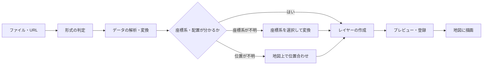

# データパイプライン

morivis は、ファイルや URL から受け取ったデータを解析し、座標系や配置を確定してから地図へ登録する。
この文書では、データ変換の全体像と処理の役割分担をまとめる。

## 全体像

## 入力と解析

入力ファイルは、拡張子・内容・関連ファイルの組み合わせから形式を判定し、対応するフォームとパーサーへ渡す。
URL の場合は、配信元のメタデータを読み、データの種類や取得方法を確認する。

形式ごとのパーサーは、図形と属性、画像や格子、点群、モデルなど、後続の処理で扱えるデータへ変換する。
重い解析・座標変換・メッシュ生成は主に Worker で処理し、画面側は入力の選択や進行状態を扱う。

## 主な変換

| 入力の種類 | 主な変換先 |
| --- | --- |
| ベクター・表・ログ | 図形と属性をまとめた地物データ。表の座標列やログの位置情報からも点・線を作る。 |
| 画像・格子 | 地図上に配置する画像や数値バンド。標高格子は3Dメッシュにも変換できる。 |
| 点群・サーフェス | 点群やメッシュとして扱うほか、標高格子へ変換してラスター表示できる。 |
| 3Dモデル | 必要に応じて描画可能なモデル形式へ変換し、単位・向き・配置を設定する。 |
| タイル・リモート配信 | 配信先と表示設定をレイヤーに持たせ、描画時に必要な範囲を取得する。 |

同じ入力でも、用途に応じてベクター・ラスター・3Dモデルなどの表示方法を選べる場合がある。
変換結果は共通の内部モデル `MorivisLayerEntry` にまとめ、UIとストアで扱う。

## 形式別の変換

### ベクター・表・地理データベース

| 形式 | 処理・登録先 |
| --- | --- |
| GeoJSON | 点・線・面と属性を読み込み、ベクターとして登録する。高さを持つ図形は3D表示にも使う。 |
| GeoJSONSeq | 行やレコードごとのGeoJSONをまとめ、GeoJSONと共通の登録処理へ渡す。 |
| TopoJSON | 共有された境界から図形を復元し、ベクターとして登録する。 |
| WKT | テキストから図形を読み取り、ベクターとして登録する。 |
| GML | XMLから図形・属性・座標系を読み取り、ベクターとして登録する。 |
| KML / KMZ | 地物はベクター、重ね合わせ画像はラスター、参照モデルは3Dモデルとして登録する。 |
| GeoRSS | フィード内の位置や図形をベクターとして登録する。 |
| OpenStreetMap XML / PBF | ノード・ウェイ・リレーションから図形を組み立て、ベクターとして登録する。 |
| Shapefile | 関連ファイルから図形・属性・座標系を読み取り、ベクターとして登録する。 |
| FlatGeobuf | バイナリの地物データをGeoJSONへ変換し、ベクターとして登録する。 |
| GeoParquet | 空間テーブルから図形と属性を取り出し、ベクターとして登録する。 |
| GeoArrow / Feather | 列指向の図形・属性データを読み込み、地図上に表示する。 |
| GeoPackage | 選択したテーブルやタイルを読み込み、ベクターまたはラスターとして登録する。 |
| SQLite / SQL dump | 空間カラムや座標列から地物を作り、ベクターとして登録する。 |
| Esri FileGDB | データベース内のレイヤーを選び、図形と属性をベクターとして登録する。 |
| MapInfo TAB | 関連ファイルから図形・属性・座標系を読み取り、ベクターとして登録する。 |
| MapInfo MIF/MID | 図形と属性の組を読み込み、ベクターとして登録する。 |
| SIS BDS | 線・境界線・文字位置と属性をGeoJSONへ変換し、ベクターとして登録する。 |
| GCD | 図形の境界線と属性を読み込み、ベクターとして登録する。 |
| CSV / TSV | 指定した座標列からポイントを作り、行の値を属性として登録する。 |
| S-57 | 基本セルと更新差分から地物を組み立て、点・線・面として登録する。 |

### 移動・観測・時系列データ

| 形式 | 処理・登録先 |
| --- | --- |
| GPX | トラック・ルート・ウェイポイントを線や点として登録する。 |
| TCX | 運動記録の軌跡と計測点をベクターとして登録する。 |
| FIT | GPS記録から軌跡・計測点・コースポイントを取り出して登録する。 |
| Garmin GDB | ルート・トラック・ウェイポイントをベクターとして登録する。 |
| NMEA 0183 | GNSSログから位置と計測値を取り出し、軌跡やポイントとして登録する。 |
| AISログ | 船舶ごとの位置報告をポイントや航跡へ変換して登録する。 |
| GTFS | 停留所や路線を地物へ変換し、交通データとして登録する。 |
| Location History | 位置履歴をポイントや軌跡へ変換して登録する。 |
| MF-JSON | 移動地物の位置と時間情報を読み込み、地図上に表示する。 |
| TLE / OMM | 軌道要素から指定期間の衛星位置と地上軌跡を計算し、点や線として登録する。 |
| CZML | 時間変化する位置・図形・画像マーカー・3Dモデルを、ベクターやモデルと時系列の設定に変換する。 |

### CAD・測量・都市モデル

| 形式 | 処理・登録先 |
| --- | --- |
| DXF / DWG | 図面の点・線・面をベクターとして登録するか、GLBへ変換して3Dモデルとして配置する。 |
| JWW / JWC | 図面の線・文字・塗りつぶしを読み込み、位置合わせしてベクターとして登録する。 |
| SXF（SFC） | CAD図面の図形と文字を読み込み、ベクターとして登録する。 |
| DGN V7 | 図形と文字位置を読み込み、座標変換または位置合わせして2Dベクターとして登録する。 |
| DM | 数値地形図の地物を読み込み、座標変換または位置合わせしてベクターとして登録する。 |
| SIMA | 測量座標と図形を読み込み、ベクターとして登録する。 |
| 法務局地図XML | 筆界や地番を読み込み、ベクターとして登録する。 |
| DRM | 道路リンクやノードと属性を読み込み、座標変換してベクターとして登録する。 |
| OpenDRIVE | 道路基準線や車線面を生成し、2Dベクターとして登録する。 |
| LandXML | TIN地表面を読み込み、3Dメッシュ・等高線・標高ラスターへ変換する。 |
| CityGML | 選択したLODの建物形状を読み込み、3D表示または2Dベクターとして登録する。 |
| CityJSON | 都市モデルの面・立体形状と属性を読み込み、3D表示する。 |
| CEDXM | 建築部材や間取りを読み込み、2D図面またはGLBの簡易3Dモデルへ変換する。 |

### 画像・格子・文書・動画

| 形式 | 処理・登録先 |
| --- | --- |
| GeoTIFF | 画像や数値バンドを読み込み、ラスターとして登録する。標高格子は3Dメッシュにも変換する。 |
| PNG / JPEG / WebP | 付属の位置情報または手動の位置合わせを使い、画像を地図上に配置する。 |
| 写真（EXIF GPS） | 撮影位置をポイントにし、写真を持つ地物として登録する。 |
| PDF / GeoPDF | ページ画像や図形を取り出し、位置情報または位置合わせを使って登録する。 |
| SVG | 図形をベクターへ変換し、位置合わせして登録する。 |
| Excel（XLSX） | 表の座標列からポイントを作るか、図面を画像・ベクターへ変換して位置合わせする。 |
| PowerPoint（PPTX） / Word（DOCX） | 文書内の図面を画像・ベクターへ変換し、位置合わせして登録する。 |
| JPEG2000 / GeoJP2 | 画像と位置情報を読み取り、ラスターとして登録する。 |
| ENVI / ESRI BIL | ヘッダーと画像本体からバンド配列を作り、ラスターや3Dメッシュとして登録する。 |
| ASCII Grid | テキストの格子値を読み込み、ラスターや3Dメッシュとして登録する。 |
| SRTM HGT | 標高格子とファイル名の位置情報を読み取り、ラスターや3Dメッシュとして登録する。 |
| 基盤地図DEM XML | 標高値を格子へ変換し、ラスターや3Dメッシュとして登録する。 |
| NetCDF | 多次元配列から表示する変数や断面を選び、ラスターや3Dメッシュとして登録する。 |
| GRIB2 | 気象格子の値を取り出し、ラスターとして登録する。 |
| HDF5 | 観測値や配列を取り出し、データに応じてベクターやラスターとして登録する。 |
| HRIT/LRIT | 衛星観測画像を展開し、ラスターとして登録する。 |
| Zarr / GeoZarr | 地理座標を持つ配列を選び、必要なチャンクを取得してラスター表示する。 |
| 動画（MP4 / WebM / MOV / M4V / OGV） | 撮影位置があれば動画付きポイントとして登録し、位置合わせでは四隅を指定して地図上で再生する。 |
| アニメーションGIF | 動画へ変換し、位置合わせして地図上で再生する。 |

### 点群・3Dモデル

| 形式 | 処理・登録先 |
| --- | --- |
| LAS / LAZ / COPC / PLY / PCD / XYZ / OBJ点群 | 座標と色を点群として登録する。用途に応じて標高ラスターやメッシュへ変換する。 |
| E57 | スキャンの位置と色を反映した点群へ変換し、共通の点群登録処理へ渡す。 |
| GLB / glTF | モデルを読み込み、位置・向き・大きさを設定して登録する。 |
| OBJ / 3DS / DAE / 3DM / VRML / FBX | モデルと関連する材質・画像を読み込み、3Dモデルとして配置する。 |
| USD / USDZ | シーンやモデルを読み込み、3Dモデルとして配置する。 |
| DRC / 3MF / AMF / STL | 形状をメッシュとして読み込み、3Dモデルとして配置する。 |
| STEP / IGES | CADの立体・曲面をGLBへ変換し、共通のモデル配置処理へ渡す。 |
| VTK | メッシュや格子から外表面を取り出し、解析値で色付けしたGLBへ変換する。 |
| IFC | 部材の形状と属性を読み込み、BIMモデルとして配置する。 |
| BCF | 課題・コメント・視点を読み込み、登録済みIFCモデルの部材確認に使う。 |
| VRM / PMX | 骨格や材質を持つモデルを読み込み、3Dモデルとして配置する。 |
| RIK | 格納された3DSとテクスチャを取り出し、共通のモデル配置処理へ渡す。 |
| Minecraft MCA | 地形のブロックからGLBを生成し、地図上に配置する。 |
| Roblox RBXL / RBXLX | ワールドのパーツをGLBへ変換し、地図上に配置する。 |
| SPZ | Gaussian Splattingデータを読み込み、地図上に配置する。 |

### タイル・リモート配信

| 形式・サービス | 処理・登録先 |
| --- | --- |
| ラスタータイル / ベクタータイル（MVT・MLT） | URLやローカルのタイル一式から、タイルレイヤーを作る。 |
| PMTiles / MBTiles | 格納されたタイルの種類を調べ、ラスターまたはベクターのタイルレイヤーとして登録する。 |
| 3D Tiles | タイル構成を読み込み、必要な3Dデータを取得して表示する。 |
| WMS / WMTS | 配信レイヤーを選び、画像の配信先をラスターとして登録する。 |
| WCS | 範囲を指定して格子データを取得し、ラスターとして登録する。 |
| WFS / OGC API - Features | 配信元から地物を取得し、ベクターとして登録する。 |
| ArcGIS | サービスやWebMapからレイヤー情報を読み取り、対応するレイヤーとして登録する。 |
| STAC / COG | カタログのアセットやCOGを参照し、画像・格子データを登録する。 |
| CSW | カタログを検索し、配信リンクから各形式の読み込みへ進む。 |

## 座標系と位置合わせ

埋め込み情報や付属ファイルから座標系を取得できる場合は、それを使って地図上の位置を求める。
ベクターは基本的にWGS84の経緯度へ変換し、ラスターやモデルは描画に必要な座標変換・配置情報を準備する。

座標系が不明な場合は、座標系選択（Zone）で投影法を確定してから変換する。
位置情報がない画像や図面などは、位置合わせ（GeoRef）で地図上の四隅を指定する。座標系の選択後に位置合わせへ進む場合もある。
3Dモデルでは、地図上の位置・向き・大きさを調整する。

ベクターや点群の位置合わせには一時的なプレビュー画像を使うが、確定時には元の図形や点群へ変換を適用する。

## レイヤーの作成と登録

通常は各フォームがレイヤーを作り、位置合わせを経たデータは共通の確定処理でレイヤーを作る。
登録前に地図上でプレビューし、確定したレイヤーを一覧へ追加する。複数のレイヤーをまとめて登録する場合もある。

登録後は、レイヤーの定義から描画用の設定を生成し、MapLibre・deck.gl・three.jsへ渡す。
プレビューや処理中の一時状態は、保存・同期するレイヤーの定義と分けて扱う。

## 実装の役割分担

以下のパスは `frontend/src/routes/map/` を基準とする。

| 処理 | 主な実装 |
| --- | --- |
| 入力の受付・形式判定 | `components/upload/` の `FileManager.svelte`、`upload-drop.ts`、`upload-drop-matchers.ts` |
| フォームの選択 | `components/upload/dialog-registry.ts` |
| 形式ごとの解析・変換 | `utils/formats/`、`components/upload/form/` |
| 座標変換・位置合わせ | `utils/proj/`、`utils/transform/`、`components/upload/transform-policy.ts` |
| 位置合わせ後のレイヤー作成 | `components/upload/form/transform/finalize-georef.ts`。`+page.svelte` は生成結果のプレビュー登録・通知・画面の終了を扱う |

形式ごとの対応範囲や制限は、`utils/formats/<format>/` の実装・定義・READMEを参照する。
内部モデルと描画系の境界は [内部レイヤーモデル](./architecture/entry-model.md)、検証方法は [開発・検証](./development.md) を参照する。

### 動的フォームのprops

`components/upload/dialog-props.ts` がフォーム分類ごとの入力を定義し、`dialog-registry.ts` の `defineDialog()` が登録するフォームのpropsと照合する。ロード結果は分類とコンポーネントの組を保持し、`DialogRenderer.svelte` は分類を絞り込んで対応するpropsを渡す。フォームを追加するときは、既存の分類で必要な値を渡せるか確認する。
